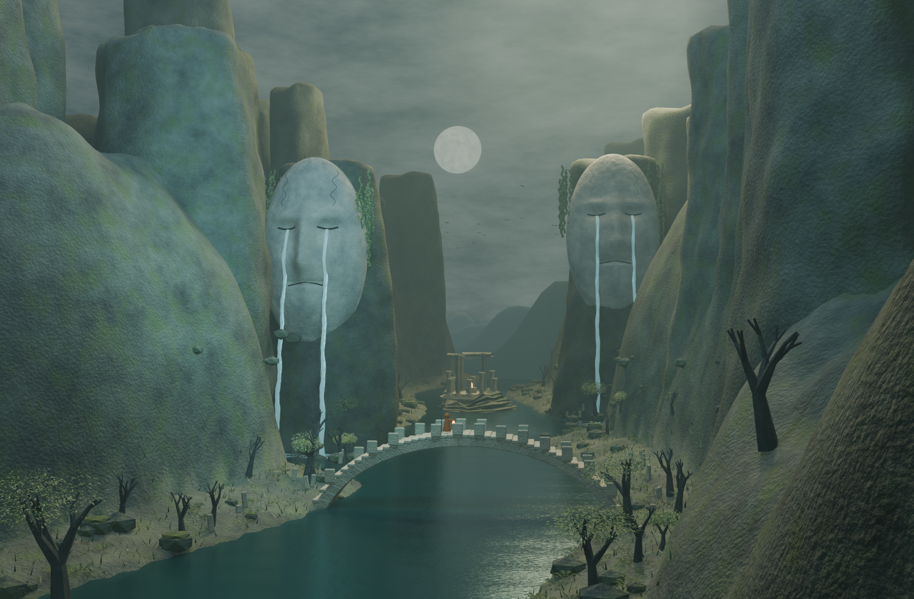

# Valley of Tears



A dark fantasy valley watched over by two stone mourners. Their tears feed a
jade river beneath a ruined pilgrim bridge and a forgotten sanctuary.

This repository preserves the editable Blender artwork, a finished ray-traced
camera flyby, every rendered frame, and an interactive Godot adaptation.

## Open It

- Interactive project: `godot/project.godot` (Godot 4.7.2, Forward+).
- Editable artwork: `blender/valley-of-tears.blend` (Blender 5.3).
- Animated scene: `blender/valley-of-tears-flyby.blend`.
- Finished video: `blender/valley-of-tears-flyby.mp4`.
- Godot previews: `godot/godot-valley.png` and `godot/godot-river.png`.

From the repository root:

```sh
godot --path godot
```

The first launch imports the included assets. Vulkan Forward+ was verified on
an NVIDIA GeForce RTX 3060 Laptop GPU with 6 GB of VRAM. VSync is disabled and
the frame rate is capped at 60 to avoid the observed desktop presentation stall.

## Explore

Click the scene to capture the mouse. Move with WASD and look with the mouse.
E, Space, or Up rises; Q, Ctrl, or Down descends. Shift triples flight speed,
the mouse wheel adjusts speed, R restores the entrance view, and Esc releases
the mouse. This is a free-flight camera and passes through geometry.

## Artwork And Rendering

All geometry and materials were created for this scene in Blender through MCP.
The 12-second flyby contains 288 frames at 24 fps, rendered with Cycles OptiX,
motion blur, and denoising at 1280 x 840. The final MP4 and its complete PNG
sequence are included. No render is left running.

Godot reuses the actual Blender meshes through glTF. Its real-time adaptation
adds baked albedo and normal maps, world triplanar mapping, animated river and
waterfall shaders, impact ripples, local spray, volumetric fog, ambient occlusion,
soft shadows, screen-space reflections, and a local reflection probe. The probe
supplies reflections only; sky lighting supplies diffuse ambient illumination.
Godot uses rasterized Forward+ effects; the Blender video uses ray tracing.

## Validation

```sh
godot --headless --path godot --script res://tests/test_camera.gd
godot --headless --path godot --quit-after 5
godot --path godot --disable-vsync --script res://tests/verify_live.gd
ffmpeg -v error -i blender/valley-of-tears-flyby.mp4 -f null -
```

The camera suite checks movement in all directions, diagonal speed, boost,
pitch limits, mouse release, and reset. The live check exercises actual Godot
input events and captures GPU-rendered entrance and river views.

See `REUSE.md` for source decisions and `HANDOFF.md` for the saved checkpoint.
